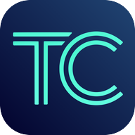
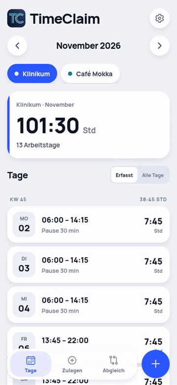
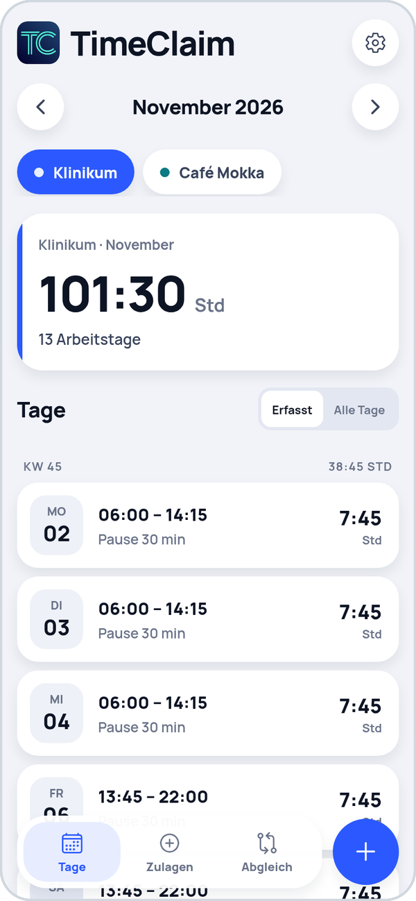
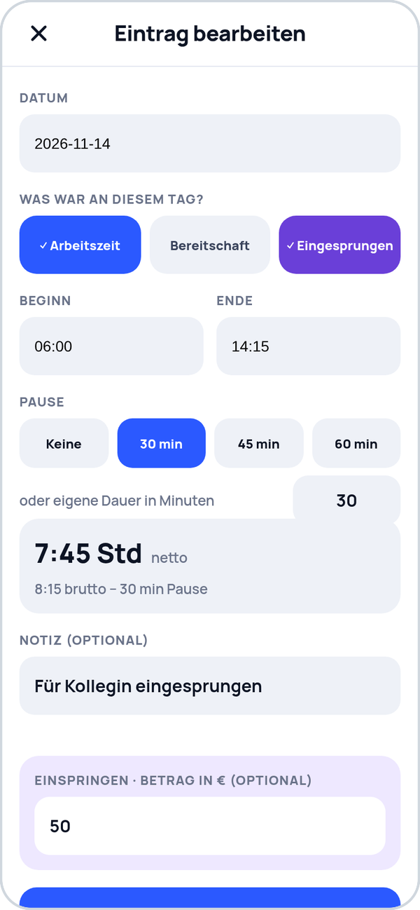
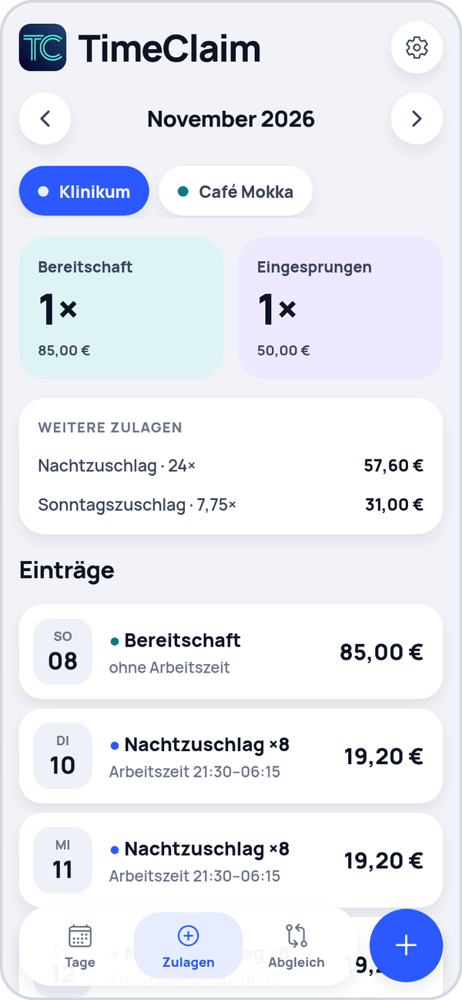
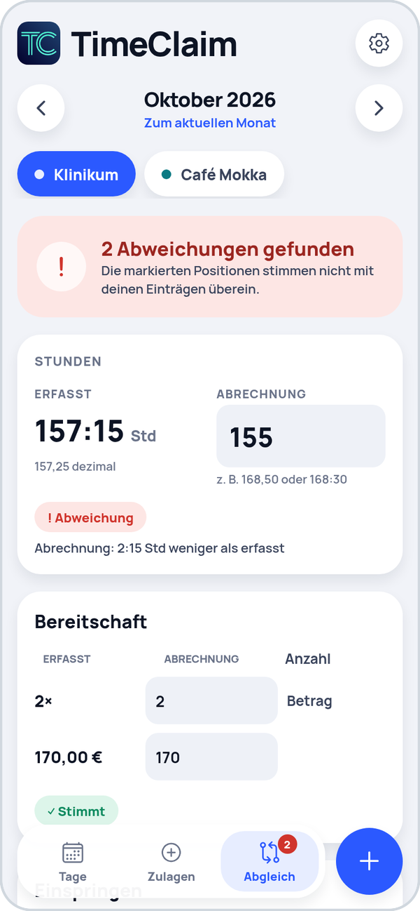
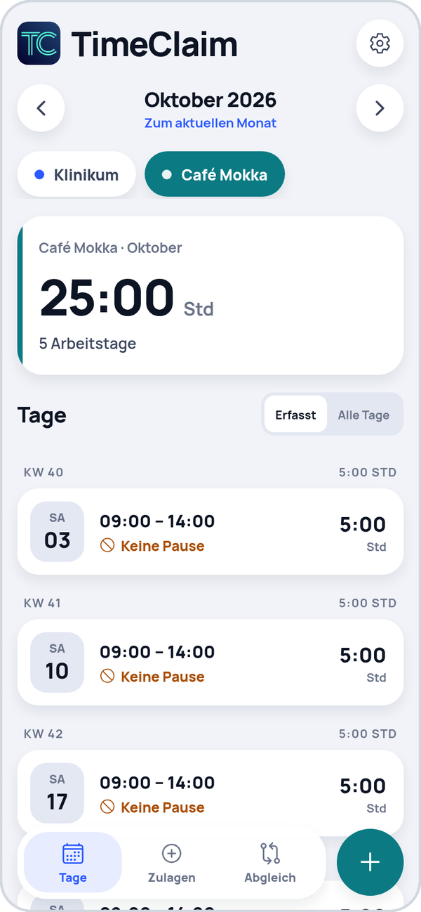

# TimeClaim

**Arbeitszeiten und Zuschläge erfassen und mit der Abrechnung abgleichen.** 
Alle Daten bleiben lokal auf deinem Gerät, ohne Konto und ohne Server.

[Webseite](https://hrudek.github.io/timeclaim/) · [iPhone](#iphone) · [Android](#android) · [Datenschutz](docs/privacy.md)

 

Rundgang mit Beispieldaten · [als Video ansehen (MP4)](docs/media/timeclaim-tour.mp4)

## Was TimeClaim kann

- **Arbeitstage erfassen:** Beginn, Ende und Pause eintragen. Netto-Stunden, Nachtschichten über Mitternacht und Wochensummen rechnet die App selbst aus.
- **Zulagen festhalten:** Bereitschaft und Einspringen mit einem Tipp, dazu beliebige eigene Zuschläge wie Nacht- oder Sonntagszuschlag.
- **Mit der Abrechnung abgleichen:** Stunden und Zulagen von der Gehaltsabrechnung eintragen. TimeClaim zeigt sofort, wo etwas fehlt oder nicht stimmt.
- **Mehrere Jobs:** Hauptjob und Minijob getrennt führen, jeweils mit eigener Farbe.
- **Privat:** Kein Konto und kein Server. Sicherungen exportierst du selbst.

<table>
  <tr>
    <td align="center" width="20%"> <b>Monatsübersicht</b></td>
    <td align="center" width="20%"> <b>Tag erfassen</b></td>
    <td align="center" width="20%"> <b>Zulagen</b></td>
    <td align="center" width="20%"> <b>Abgleich</b></td>
    <td align="center" width="20%"> <b>Mehrere Jobs</b></td>
  </tr>
</table>

## Installieren

### iPhone

1. Installiere [TestFlight](https://apps.apple.com/app/testflight/id899247664) aus dem App Store.
2. Öffne den TestFlight-Einladungslink für TimeClaim, den du erhalten hast, und tippe auf **Akzeptieren** und **Installieren**.

Updates kommen automatisch über TestFlight.

### Android

1. Lade die Datei `TimeClaim-<Version>.apk` aus dem [neuesten Release](https://github.com/hrudek/timeclaim/releases/latest) herunter.
2. Öffne sie. Erlaube bei Nachfrage die Installation aus dieser Quelle (Browser oder Dateien-App).

Bei einer neuen Version meldet sich die App beim Start. Lade dann die neue APK herunter und installiere sie über die bisherige App; deine Daten bleiben erhalten.

## Deine Daten sichern

Die Daten liegen nur auf deinem Gerät. Wenn du die App löschst oder das Gerät verlierst, sind sie weg. Exportiere deshalb regelmäßig eine Sicherung (Zahnrad oben rechts → **Daten exportieren**) und bewahre sie an einem sicheren Ort auf. Über **Aus Text wiederherstellen** spielst du sie wieder ein, auch auf einem neuen Gerät.

## Feedback

Fehler und Wünsche an timeclaim@rudek.dev oder auf dem iPhone direkt über TestFlight (Screenshot machen → Teilen → Beta-Feedback).

[Datenschutzerklärung](docs/privacy.md)

## Entwicklung

Expo (React Native). `npm ci`, dann `npm start`. Checks: `npm run lint`, `npm run typecheck`, `npm test`; CI (`.github/workflows/ci.yml`) führt sie für jeden PR aus. Builds und Releases laufen über GitHub Actions, siehe [docs/release.md](docs/release.md).

## Lizenz

MIT, siehe [LICENSE](LICENSE).
